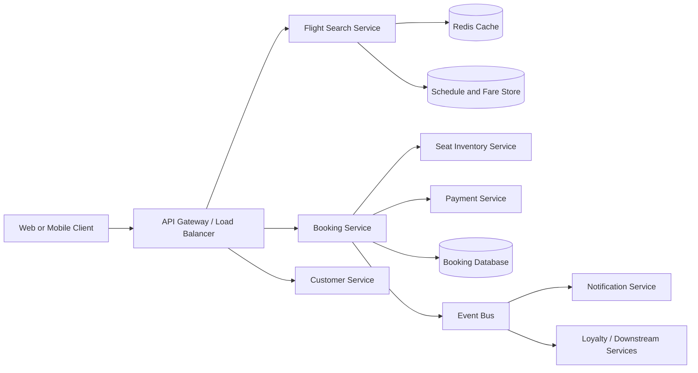

# System Design: Flight Booking Backend

[Master index](../README.md) · [Enterprise Java playbook](../FINAL-INTERVIEW-HANDBOOK.md) · [Answer book](../FINAL-INTERVIEW-ANSWER-BOOK.md) · Previous: [AWS and DevOps](../04-aws-devops/README.md) · Next: [Behavioral](../06-behavioral/README.md)

## Opening answer

I would begin by confirming scope: flight search, fare and availability, temporary seat hold, booking, payment, confirmation, and cancellation. The key non-functional needs are high availability, security, auditability, low search latency, and correctness during booking. I would separate read-heavy search from the strongly consistent inventory and booking path.

## High-level design



## Service responsibilities

- Search Service: routes, schedules, fares, and cached search results.
- Inventory Service: authoritative seat availability and holds.
- Booking Service: booking state machine and workflow orchestration.
- Payment Service: provider integration and idempotency.
- Notification Service: asynchronous email/SMS/push delivery.
- Customer Service: profiles and traveller information.

Each service is separated by business responsibility, not merely because microservices are fashionable.

## Search flow

`GET /flights?origin=YYZ&destination=YVR&date=...`

Search results may be cached because many users request the same routes and dates. Cache keys include normalized search parameters and a short TTL. The displayed result is not the final guarantee: current fare and seat availability are revalidated during the booking flow.

## Booking flow

```text
1. Validate authenticated customer and request.
2. Revalidate fare and inventory.
3. Atomically create a time-limited seat hold.
4. Create PENDING_PAYMENT booking.
5. Request payment using an idempotency key.
6. On success, confirm booking and seat.
7. Publish BookingConfirmed.
8. Notification and loyalty consumers process asynchronously.
9. On failure or timeout, reconcile status and release/expire the hold.
```

### Preventing double booking

The Inventory Service is the source of truth. Use an atomic conditional update, unique constraint, or version-based optimistic lock. Only one request can change a seat from `AVAILABLE` to `HELD`.

### Payment idempotency

Every payment request carries a stable idempotency key tied to the booking attempt. A client retry must return the prior result rather than charge twice. Persist the request state before calling the provider, and reconcile ambiguous timeouts by querying provider status.

### Distributed transaction

Do not claim `@Transactional` rolls back payment and every service. Use a saga/state machine:

```text
PENDING → SEAT_HELD → PAYMENT_PENDING → CONFIRMED
                         ↘ FAILED → SEAT_RELEASED
```

Compensation may release a seat or refund a captured payment. Notification failure does not cancel a confirmed booking; it is retried through a queue and dead-letter process.

## Reliability

- Strict downstream connection and response timeouts
- Limited retries with exponential backoff and jitter
- Circuit breakers for unhealthy dependencies
- Bulkheads to isolate resource pools
- Idempotent consumers
- Dead-letter queues and replay procedures
- Multi-instance deployment and health-based traffic routing
- Audit records for booking and payment state changes

Retries are used only for safe/idempotent operations or when idempotency keys protect the business action.

## Data choices

Use a relational database for bookings, seat holds, and payments because constraints and transactions matter. Redis supports search caching and possibly short-lived derived data, but authoritative seat state remains in the transactional store.

## Security

- TLS in transit and encryption at rest
- OAuth/OIDC authentication and role-based authorization
- Tokenization and a compliant payment provider; do not store raw card data
- Least-privilege service roles
- Input validation and safe error responses
- Audit logs with sensitive-data redaction
- Rate limiting and bot/abuse protection

## Observability

Monitor search and booking latency, payment success, booking conversion, inventory conflicts, message lag, queue failures, and saturation. Trace a request using a correlation/trace ID from the gateway through booking, inventory, and payment.

## Follow-up questions

- Why microservices instead of a monolith?
- What happens if payment succeeds but the response times out?
- How long should a seat hold last?
- How do you handle two users choosing seat 10A?
- What if notification fails?
- What data can be cached?
- How do you deploy without interrupting bookings?
- How do you recover messages from a dead-letter queue?
