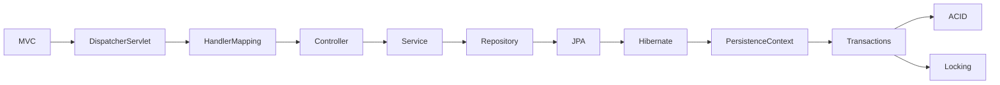
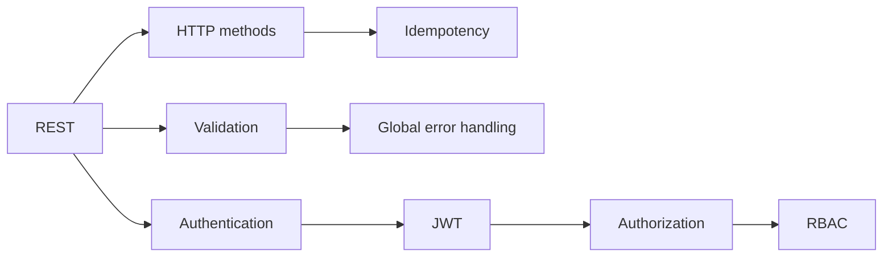
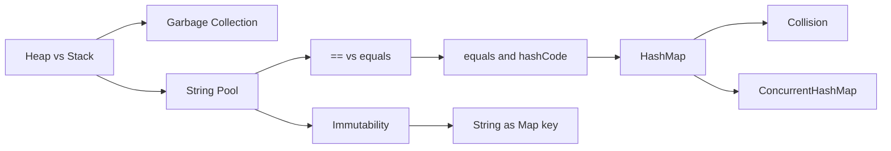
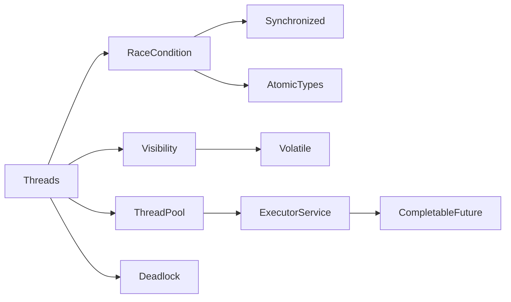
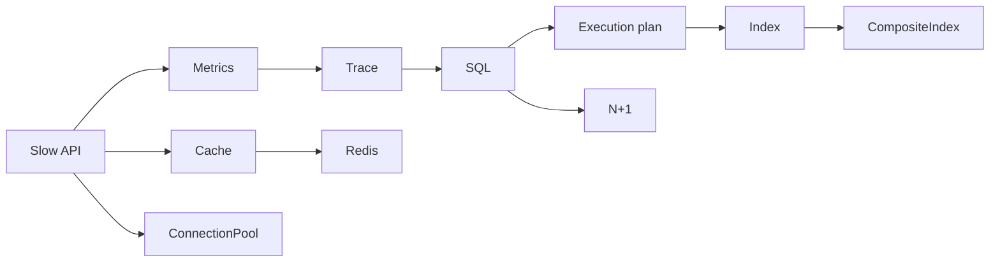
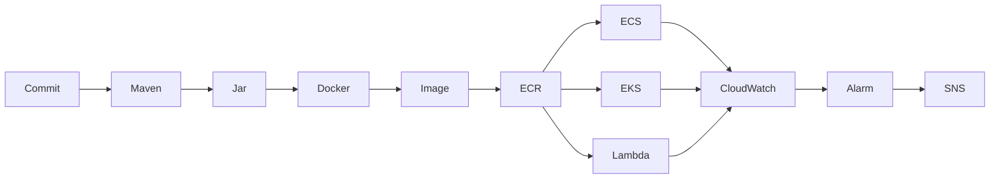
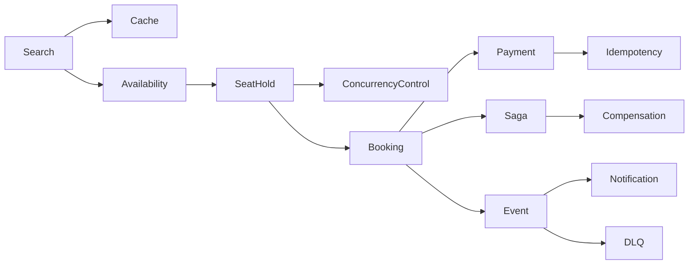

# Interlinked Interview Question Map

[Master index](../README.md) · [Enterprise Java playbook](../FINAL-INTERVIEW-HANDBOOK.md) · [Answer book](../FINAL-INTERVIEW-ANSWER-BOOK.md) · Previous: [Resume script](../07-resume/RESUME-SCRIPT.md)

Use these paths to practise how one answer naturally creates the next question.

## Spring request path



Practice chain:

1. What is MVC?
2. What happens when a request reaches Spring Boot?
3. How does the `DispatcherServlet` find a controller?
4. Why have a service layer?
5. What is dependency injection?
6. What is a bean and how is it created?
7. JPA versus Hibernate?
8. What is the persistence context?
9. What does `@Transactional` do?
10. Can it roll back another microservice?

## REST and security path



Natural follow-ups:

- POST versus PUT?
- `401` versus `403`?
- How do you protect a payment endpoint from duplicate requests?
- What information belongs in a JWT?
- Why must the backend validate data already checked by React?
- Why use DTOs?

## Java memory and collections path



Natural follow-ups:

- What causes a memory leak?
- Why are Strings immutable?
- How does `HashMap` provide average O(1)?
- What happens during a collision?
- Why must map keys have stable hash codes?
- `HashMap` versus `ConcurrentHashMap`?

## Collection-choice path

```text
Collection requirement
├─ indexed ordered reads → ArrayList
├─ queue/deque operations → ArrayDeque
├─ key-based lookup → HashMap
├─ uniqueness → HashSet
└─ priority ordering → PriorityQueue
```

Correct the common trap: `LinkedList` is not automatically ideal for a boarding queue or middle insertions. In modern Java, `ArrayDeque` is usually the better queue, and middle insertion into `LinkedList` still requires O(n) traversal unless a node/iterator position is already available.

## Concurrency path



Natural follow-ups:

- Concurrency versus parallelism?
- Why not create a thread per request?
- `volatile` versus `synchronized`?
- What makes `count++` unsafe?
- How do you size a pool?
- How do asynchronous failures propagate?

## Database-performance path



Natural follow-ups:

- How did you measure the improvement?
- Why not create every index?
- Why does composite-index order matter?
- How do you fix N+1?
- How do you prevent stale cache?
- Can a bigger connection pool reduce performance?

## AWS deployment path



Natural follow-ups:

- AWS CLI versus Lambda?
- Image versus container?
- ECR versus ECS/EKS?
- Lambda versus a long-running Spring Boot service?
- Liveness versus readiness?
- What triggers rollback?
- Blue-green versus canary?

## Cognizant debugging path

```mermaid
flowchart LR
    UserIssue[Unexpected cart behavior] --> CorrelationId
    CorrelationId --> ELK
    ELK --> Payload
    Payload --> Contract
    Contract --> Condition[Business-rule branch]
    Condition --> Reproduce
    Reproduce --> FixOrTicket[Fix or upstream ticket]
    FixOrTicket --> Tests
    Tests --> Release
    Release --> Canary
```



Follow-ups to rehearse:

- Which JSON field caused the branch?
- How did you find the correlation ID?
- How did you prove the upstream response was responsible?
- What did you change in code?
- Which tests did you add?
- How did you safely deploy it?

## Flight-booking design path



Natural follow-ups:

- What is cached and what is authoritative?
- How do you stop double booking?
- What if payment succeeds but the response is lost?
- What if notification fails?
- Why a queue/event instead of a synchronous call?
- Which failures should be retried?

## Behavioral-to-technical map

| Behavioral question | Technical follow-up |
|---|---|
| Tell me about a production issue | Correlation IDs, logs, tracing, rollback, root cause |
| Tell me about performance work | Baseline, p95, SQL plan, indexes, load test |
| Tell me about modernization | Service boundaries, APIs, tests, Docker, independent releases |
| Tell me about deployment improvement | Maven, pipeline, ECR, runtime, health checks |
| Tell me about cross-team conflict | API contract, evidence, ownership, communication |
| Tell me about asynchronous work | Dependency graph, executor, timeout, fallback |

## Final self-test

For any answer, be ready to explain:

1. What business problem existed?
2. What was the architecture?
3. What exactly did you own?
4. Which class, endpoint, field, query, or pipeline step changed?
5. How did you test it?
6. How did you measure it?
7. How did you deploy and monitor it?
8. What would you do differently now?
